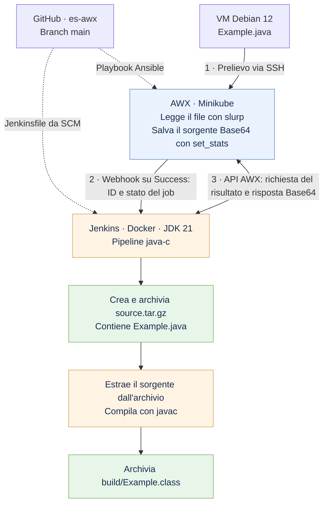

# Esercizio bonus: AWX e Jenkins

L'obiettivo è prelevare un file da una VM con AWX e far partire una pipeline
Jenkins che lo archivi e lo usi per una build. Il Jenkinsfile deve essere letto
da un repository GitHub o GitLab.

In questo progetto il file è `Example.java`. AWX lo legge via SSH; Jenkins
recupera il contenuto da AWX, crea `source.tar.gz` e compila il sorgente estratto.
Il repository è [es-awx](https://github.com/tom-fra-808/es-awx), branch `main`.

## Ambiente usato

Il lavoro è stato svolto sul Mac con:

- una VM Debian 12 gestita da Vagrant e VirtualBox;
- AWX su Minikube, profilo `awx-lab` e namespace `awx`;
- Jenkins nel container Docker `jenkins-awx`, con JDK 21, sulla porta `8081`.

## Installazione di AWX

Servono Docker Desktop avviato, Minikube e kubectl. I comandi vanno eseguiti
dalla cartella del repository.

L'installazione di AWX è stata una delle difficoltà dell'esercizio per i limiti
hardware del Mac. AWX, il database, Minikube, Jenkins e la VM condividono le
stesse risorse. Nel laboratorio Minikube è configurato con 2 CPU e 3 GB di RAM;
i valori vanno adattati alle risorse disponibili sul proprio computer.

1. Avviare Minikube:

   ```bash
   minikube start -p awx-lab --driver=docker --cpus=2 --memory=3072
   ```

2. Installare AWX Operator. Il file
   [`operator/kustomization.yaml`](operator/kustomization.yaml) usa la versione `2.19.1`:

   ```bash
   kubectl --context awx-lab apply -k operator/
   kubectl --context awx-lab wait --for=condition=Established crd/awxs.awx.ansible.com --timeout=120s
   kubectl --context awx-lab -n awx rollout status deployment/awx-operator-controller-manager --timeout=600s
   ```

3. Creare AWX con [`awx.yaml`](awx.yaml) e seguire l'avvio dei pod:

   ```bash
   kubectl --context awx-lab apply -f awx.yaml
   kubectl --context awx-lab -n awx get pods -w
   ```

   Attendere che web, task e database siano pronti e che la migrazione sia
   completata. `Ctrl+C` chiude il monitoraggio. In caso di problemi:

   ```bash
   kubectl --context awx-lab -n awx get events --sort-by=.lastTimestamp
   ```

4. Recuperare la password dell'utente `admin`. Su macOS:

   ```bash
   kubectl --context awx-lab -n awx get secret awx-admin-password -o jsonpath='{.data.password}' | base64 -D
   ```

5. Aprire l'accesso locale ad AWX:

   ```bash
   kubectl --context awx-lab -n awx port-forward service/awx-service 8080:80
   ```

   AWX è disponibile su [localhost:8080](http://localhost:8080).
   Il terminale del port-forward deve restare aperto durante l'esercizio.

## Schema



## File sulla VM

Il file `Example.java` usato per la prova è stato generato con l'IA e salvato in:

```text
/home/vagrant/esercizio/Example.java
```

## Configurazione AWX

In AWX sono stati configurati il Project collegato a GitHub, l'inventory con
la VM e una credenziale Machine per l'accesso SSH.

Il Job Template `Legge java da vm` esegue
[`progetto-awx/leggi-java.yml`](progetto-awx/leggi-java.yml). Il playbook controlla
che sia selezionata una sola VM, legge il file con `slurp` e verifica che non
sia vuoto. Con `set_stats` salva il contenuto Base64 nella variabile
`sorgente_java_base64`, disponibile negli artifacts del job.

Al Job Template è associata una notifica Webhook, attiva solo su Success.
La destinazione è:

```text
http://host.minikube.internal:8081/generic-webhook-trigger/invoke
```

Nel campo HTTP Headers:

```json
{
  "Content-Type": "application/json",
  "token": "<SEGRETO_WEBHOOK>"
}
```

Il valore di `token` deve coincidere con il segreto della credenziale Jenkins
`awx-webhook-token`. I segreti restano nelle credenziali dei servizi.

Nel campo Success Message Body:

```json
{
  "awx_job_id": "{{ job.id }}",
  "status": "{{ job.status }}"
}
```

Il webhook passa a Jenkins l'ID e lo stato del job. Il sorgente viene letto
successivamente dalle API AWX.

## Pipeline Jenkins

Il job `java-c` è configurato come Pipeline script from SCM e legge il
[`Jenkinsfile`](Jenkinsfile) dal branch `main` di GitHub.
Servono i plugin Pipeline, Git, Generic Webhook Trigger e Pipeline Utility Steps.

Le credenziali Jenkins sono:

| ID | Utilizzo |
| --- | --- |
| `awx-webhook-token` | Segreto condiviso con la notifica AWX |
| `awx-api-token` | Token AWX con scope Read e accesso al risultato del job |

Quando arriva il webhook, la pipeline:

1. Legge il risultato da `http://host.docker.internal:8080/api/v2/jobs/ID_DEL_JOB/`.
2. Usa `readJSON` per controllare ID, stato e presenza del sorgente.
3. Decodifica il contenuto e crea `source.tar.gz`, che viene archiviato in Jenkins.
4. Elimina il sorgente iniziale ed estrae l'archivio nella cartella `build`.
5. Compila il file estratto e archivia `build/Example.class`.

Il comando di compilazione nel Jenkinsfile è:

```bash
javac -encoding UTF-8 -d build build/Example.java
```

La pipeline ha un timeout di cinque minuti, conserva le ultime dieci build
e pulisce il workspace al termine. Gli artefatti sono registrati con fingerprint.

## Prova del flusso

Avviare il Job Template da AWX. Dopo il successo del job e della notifica,
in Jenkins deve partire automaticamente `java-c`.

La build deve terminare con `Finished: SUCCESS` e rendere scaricabili:

- `source.tar.gz`, contenente il sorgente letto dalla VM;
- `build/Example.class`, prodotto dalla compilazione.

Per verificare il passaggio del dato, modificare il sorgente sulla VM,
rilanciare AWX e controllare il contenuto del nuovo archivio.
